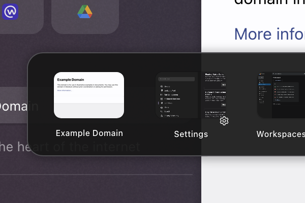

# ⚡ Better CtrlTab Panel for Zen Browser

> Re-style and customize the `Ctrl+Tab` preview switcher in Zen Browser with fluid layouts, customizable roundness, shadows, padding, and labels.

<br>

<div align="center">

## ⬇️ 1-Click Install

[](https://zen-browser.app/mods/72f8f48d-86b9-4487-acea-eb4977b18f21)

### [👉 Click here to 1-Click Install in Zen Browser 👈](https://zen-browser.app/mods/72f8f48d-86b9-4487-acea-eb4977b18f21)

*(Clicking this link while inside Zen Browser will open the native one-click installer directly)*

</div>

<br>



---

## 🛠️ Alternative Installation Methods

### Method 1: 1-Click Windows Batch Installer (`install.bat`)
If you clone or download this repo:
1. Double-click [`install.bat`](./install.bat).
2. The script automatically:
   - Detects your active Zen Browser profile.
   - Installs `chrome.css`, `preferences.json`, and `theme.json` to `chrome/zen-themes/72f8f48d-86b9-4487-acea-eb4977b18f21`.
   - Registers the mod in `zen-themes.json`.
   - Automatically enables the required Ctrl+Tab setting in `user.js`.
3. Restart Zen Browser.

---

### Method 2: Manual Profile Installation
1. In Zen Browser, open `about:support` and click **Open Folder** next to **Profile Folder**.
2. Go to `chrome/zen-themes/` (create the folders if they don't exist).
3. Create a folder named `72f8f48d-86b9-4487-acea-eb4977b18f21`.
4. Copy `chrome.css`, `preferences.json`, `theme.json`, and `image.png` into that folder.
5. In the root of your profile folder, open `zen-themes.json` and ensure it has:
   ```json
   {
     "72f8f48d-86b9-4487-acea-eb4977b18f21": {
       "id": "72f8f48d-86b9-4487-acea-eb4977b18f21",
       "name": "Better CtrlTab Panel",
       "enabled": true
     }
   }
   ```
6. **Required Setting:** Go to **Settings $\rightarrow$ General $\rightarrow$ Tabs** and ensure **"Ctrl+Tab cycles through tabs in recently used order"** is checked.
7. Restart Zen Browser.

---

### Method 3: Direct `userChrome.css`
1. Open your profile folder from `about:support`.
2. Open the `chrome` folder and create or open `userChrome.css`.
3. Copy and paste the entire contents of [`chrome.css`](./chrome.css) into your `userChrome.css`.
4. In `about:config`, make sure `toolkit.legacyUserProfileCustomizations.stylesheets` is set to `true`.
5. Restart Zen Browser.

---

## ⚙️ Customization
Once installed, customize the mod via **Settings $\rightarrow$ Zen Mods**:
* Corner roundness & panel padding
* Panel background (supports `light-dark()` colors)
* Shadow size & border styling
* Label font size, letter spacing, font family & weight
* Favicon size, padding, and outdent

---

## 👤 Credits
* Originally authored by [Pontus Sundén (@psu)](https://github.com/psu/zen-mods).
* Maintained & packaged by [alvyn16](https://github.com/alvyn16/better-ctrl-tab).
